# Optical Surface Roughness Segmentation for PBF-AM

This repository provides optical-surface semantic segmentation resources for powder bed fusion additive manufacturing (PBF-AM). It combines an annotated laser powder bed fusion (LPBF) reference dataset and vanilla U-Net models with unannotated electron beam melting (EBM) optical images for cross-process automatic-annotation demonstrations.

## PBF-AM Scope

The annotated reference dataset contains two LPBF surface states: CDF-polished and as-built. The specimens include a curved coupon with dome, slope, side, and top surface regions, together with 45-degree and 90-degree tensile-bar control specimens used for unannotated as-built inference. Unannotated EBM images provide an additional PBF-AM process baseline across the same named surface views.

The EBM examples are inference-only pseudo-labels: the reference models were trained on the annotated LPBF data, and no EBM ground-truth masks are available in this repository for quantitative accuracy assessment.

## Specimen Geometries and Surface Views

The curved coupon provides dome, slope, side, and top surface regions relative to the build direction. These views support comparison of optical surface appearance and segmentation across CDF-polished and as-built conditions.

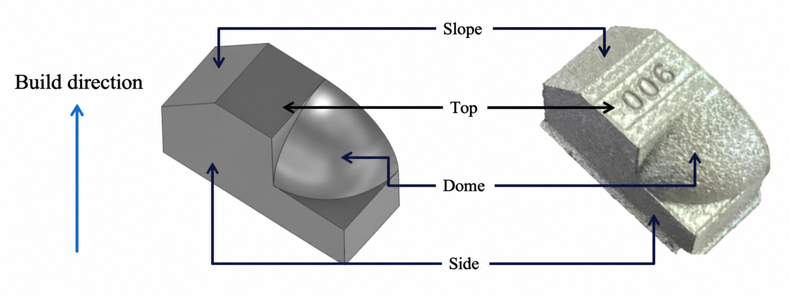

The tensile-bar controls represent 45-degree and 90-degree build orientations. The associated optical surface-characterization views include side-skin, up-skin, and down-skin regions.

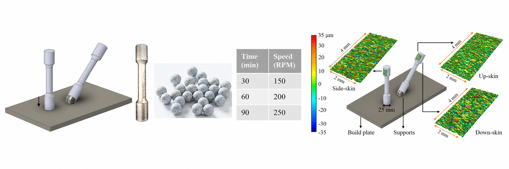

## Annotated LPBF Reference Dataset

The two annotated LPBF subsets are stored in `DATA/` and preserve a one-to-one relationship between each PNG micrograph and JSON annotation.

- `Polished_PNGs_withAnnotation`: 48 CDF-processed (polished) images. Classes: `background`, `Contour`, `Polished`, and `Powder`.
- `Asbuilt_PNGs_with_Annotation`: 13 as-built images. Classes: `background`, `Anomaly`, `Contour`, and `Powder`.

The JSON files contain class labels and ordered polygon vertices. The field-level annotation format and the class maps are documented in [`docs/DATA_DICTIONARY.md`](docs/DATA_DICTIONARY.md).

## Non-Annotated Inference Data

`DATA/Non_Annotated_PNGs/` contains 22 optical images without manual masks: 12 CDF-polished EBM images and 10 as-built images comprising EBM views and 45-degree/90-degree bar controls. Automatic annotations created by the reference U-Net checkpoints are provided in `reports/unannotated_inference/`.

For each surface state, the inference export contains:

- `prediction_overlay/`: optical images with transparent class-color predictions.
- `prediction_mask/`: single-channel PNG masks storing the predicted class index per pixel.
- `summary.json`: per-image predicted class-pixel counts and percentages.

These pseudo-labels support qualitative inspection and annotation triage only; they are not ground truth.

## Repository Layout

```text
DATA/                         Paired optical PNG images and JSON annotations
DATA/Non_Annotated_PNGs/      Complete CDF-polished and as-built inference-only PNG collections
models/reference/             Best-validation-loss polished and as-built U-Net checkpoints
reports/                      Fixed split manifests, statistics, metrics, loss figures, and inference exports
unet/                         Training, inference, and figure-generation scripts
docs/                         Data-records text and release documentation
```

## Reference Experiment

The reference vanilla U-Net uses 32 base channels, weighted cross-entropy plus multiclass Dice loss, seed 42, and a 70/20/10 train/validation/test partition. The native image sizes vary, so the reference retraining uses batch size 1.

The fixed splits contain 33/9/6 polished images and 9/2/2 as-built images. The split manifests in `reports/data_statistics/` provide the image-level assignment.

The eight held-out test triptychs are in `reports/heldout_inference/`. Each file presents the optical image, rendered manual-annotation overlay, and rendered prediction overlay side by side; its accompanying JSON records the image-level result.

## Matched Annotated Demonstrations

### CDF-Polished Side Surface

`Coupon12-side-60min250` is a CDF-polished side-surface example. The ground-truth and prediction panels are overlays on the same optical image. Red denotes `Contour`, blue denotes `Polished`, and green denotes `Powder`; uncolored regions are background.

| Optical Image | Ground Truth Overlay | Prediction Overlay |
| --- | --- | --- |
|  |  |  |

### As-Built Side Surface

`Coupon12-side-control` is the matched coupon and side-surface as-built example. Red denotes `Anomaly`, blue denotes `Contour`, and green denotes `Powder`; uncolored regions are background.

| Optical Image | Ground Truth Overlay | Prediction Overlay |
| --- | --- | --- |
| 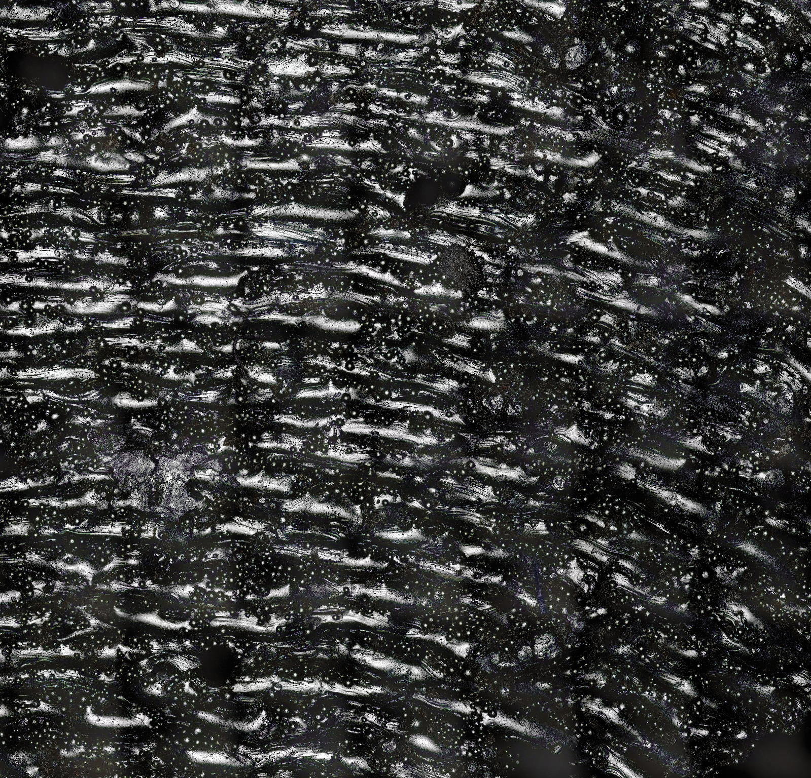 | 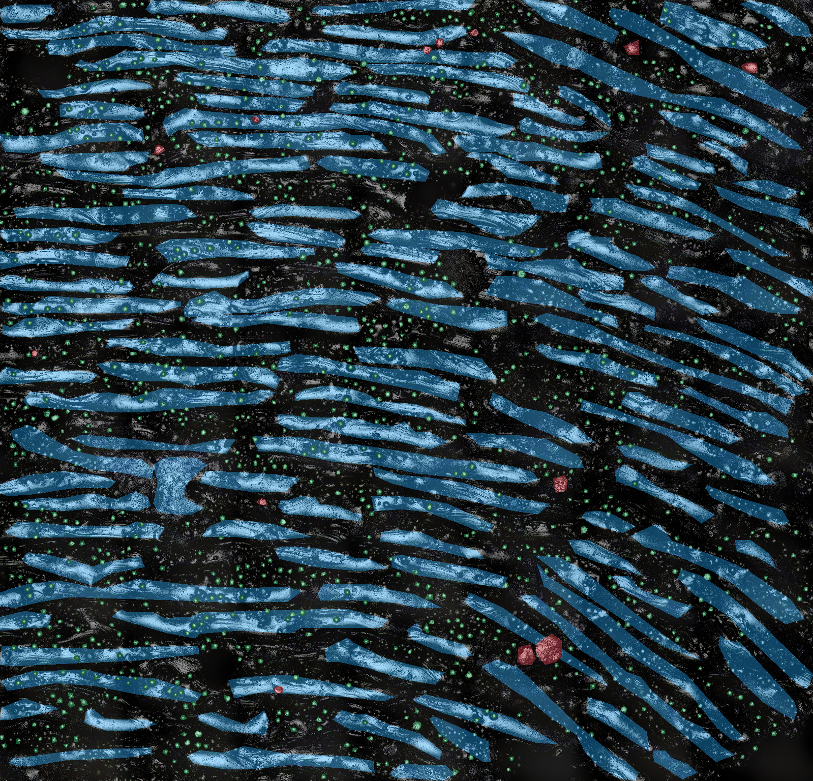 | 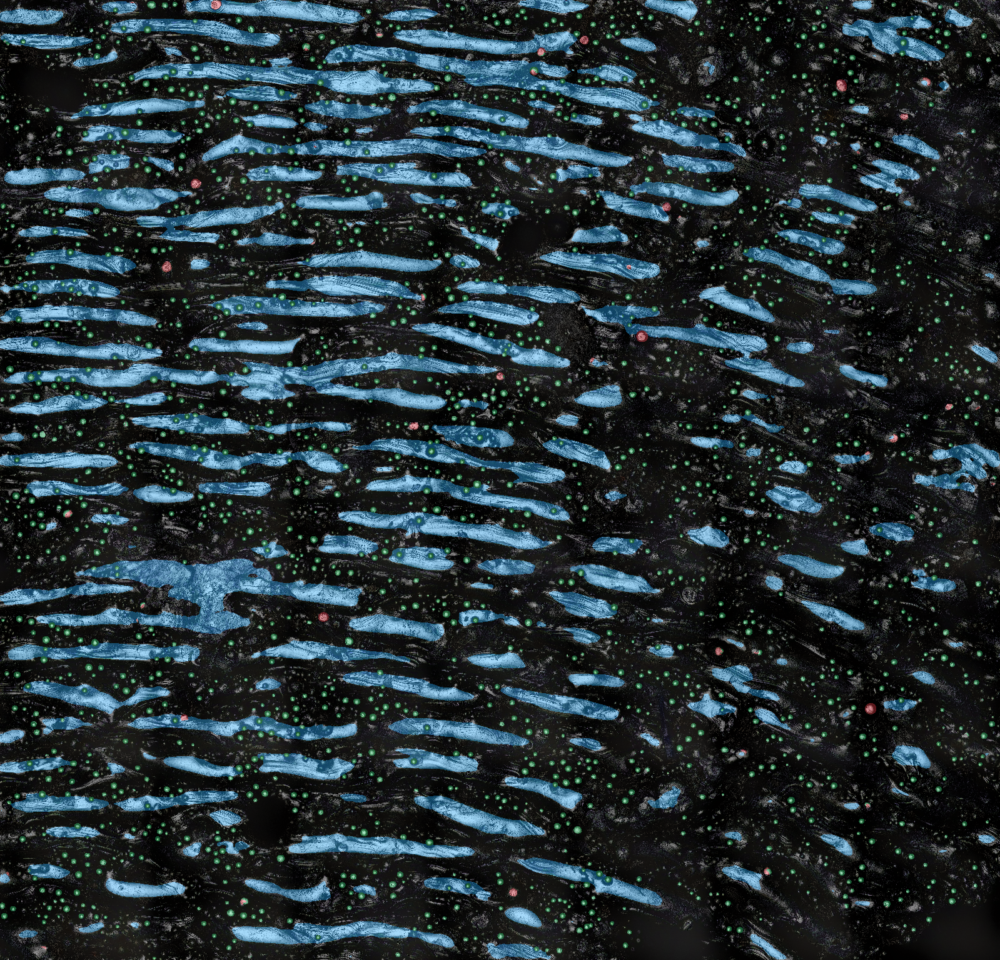 |

## Unannotated PBF-AM Baselines

The following inference-only examples compare each native optical image with its automatic annotation overlay. They do not have ground-truth masks. Red, blue, and green follow the model-specific class maps above.

### EBM Side Surfaces

| Surface state | Optical Image | Prediction Overlay |
| --- | --- | --- |
| EBM CDF-polished, side | 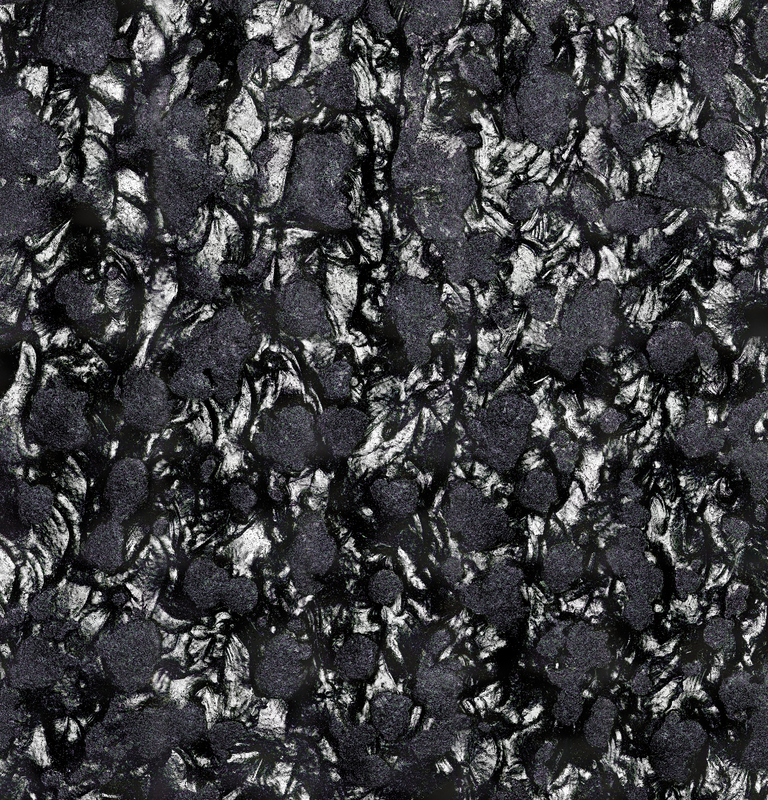 | 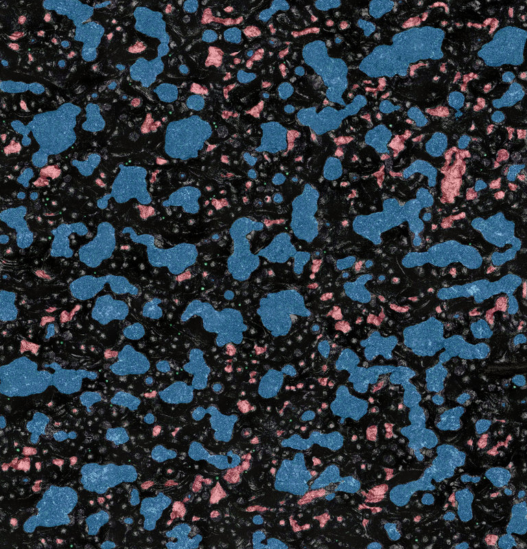 |
| EBM as-built, side | 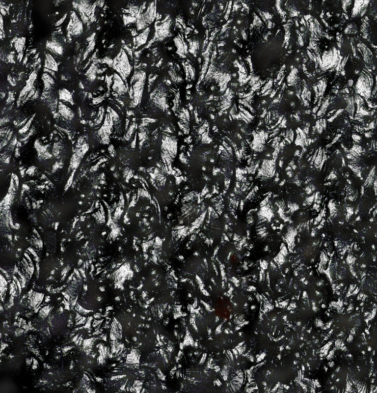 | 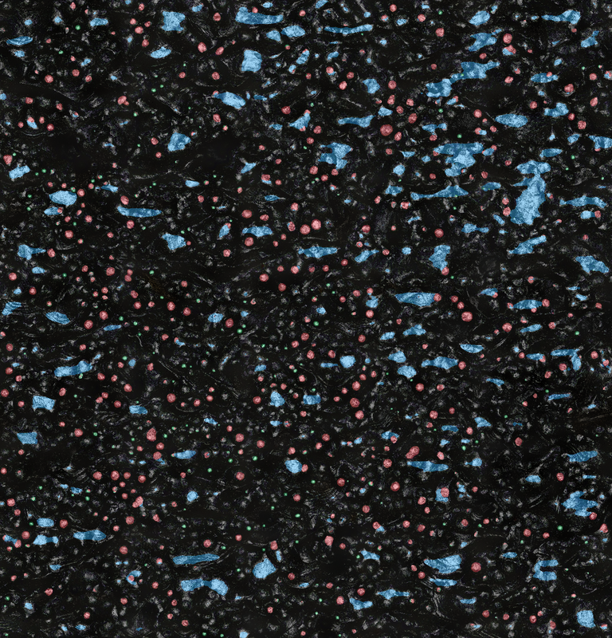 |

### As-Built Tensile-Bar Controls

| Geometry | Optical Image | Prediction Overlay |
| --- | --- | --- |
| 45-degree bar, down-skin surface | 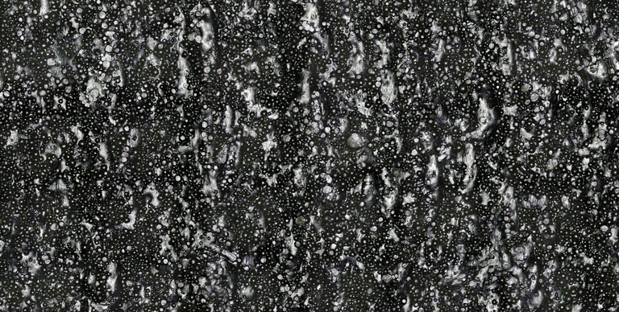 | 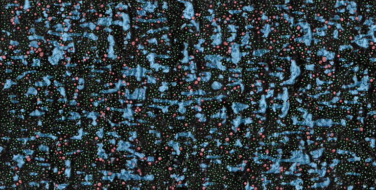 |
| 90-degree bar | 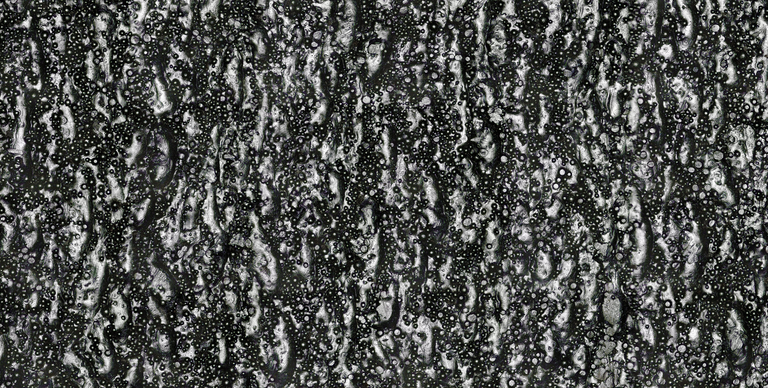 | 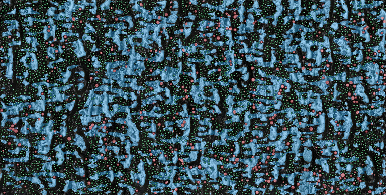 |

## Running the Models

Install the dependencies listed in `requirements.txt`, then run from the repository root:

```bash
python unet/train_unet.py --project-root . --dataset polished --output-dir outputs_polished
python unet/train_unet.py --project-root . --dataset asbuilt --output-dir outputs_asbuilt
```

To evaluate a selected checkpoint on the reproducible held-out split:

```bash
python unet/export_test_predictions.py --project-root . --checkpoint models/reference/polished_best_unet.pt --output-dir outputs_polished
```

## License and Citation

The source code is released under the [MIT License](LICENSE). The optical images, polygon annotations, manifests, reports, model checkpoints, and inference exports are released under [CC BY 4.0](DATA_LICENSE.md). Citation metadata is provided in [`CITATION.cff`](CITATION.cff).
