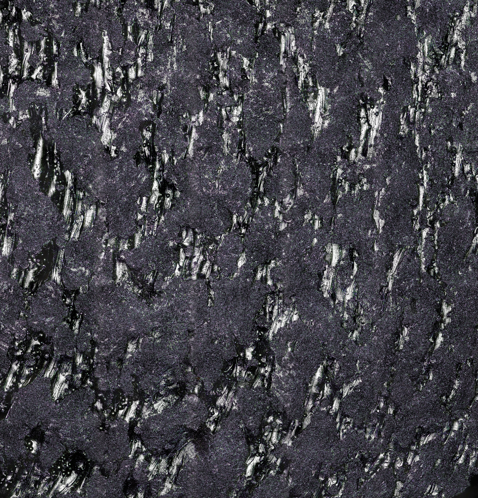
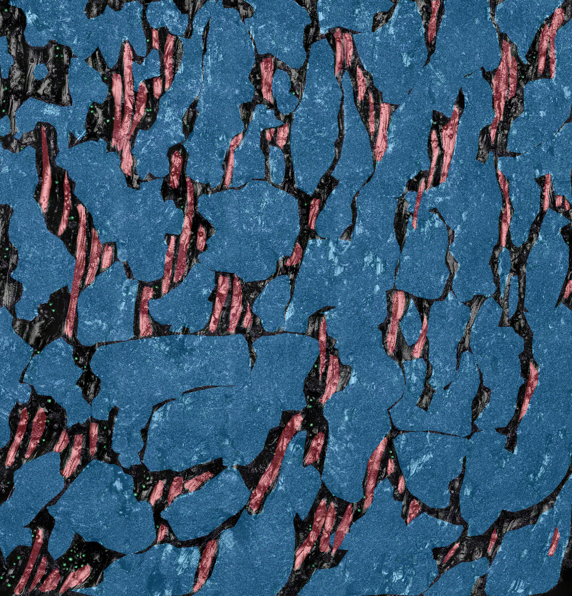
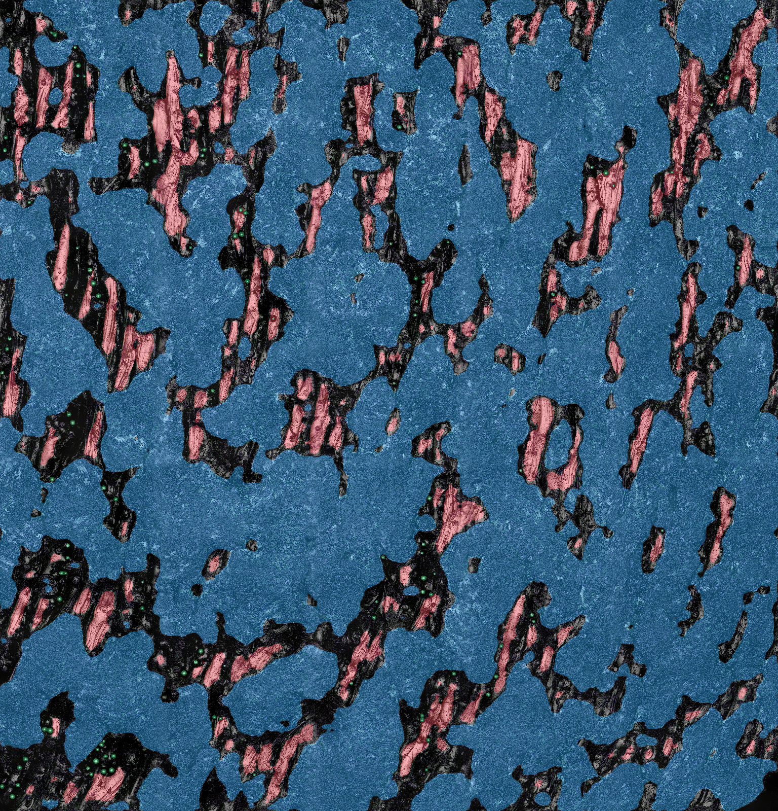

# LPBF Surface Feature Segmentation Dataset

This repository contains 61 paired LPBF optical surface images and polygon annotations, together with the reference vanilla U-Net implementation used for semantic segmentation.

## Dataset

The two subsets are stored in `DATA/` and preserve a one-to-one relationship between each PNG micrograph and JSON annotation.

- `Polished_PNGs_withAnnotation`: 48 CDF-processed (polished) images. Classes: `background`, `Contour`, `Polished`, and `Powder`.
- `Asbuilt_PNGs_with_Annotation`: 13 as-built images. Classes: `background`, `Anomaly`, `Contour`, and `Powder`.

The images cover dome, slope, side, and top surface views. The JSON files contain class labels and ordered polygon vertices.
The field-level annotation format and the class maps are documented in [`docs/DATA_DICTIONARY.md`](docs/DATA_DICTIONARY.md).

## Repository Layout

```text
DATA/                         Paired optical PNG images and JSON annotations
models/reference/             Best-validation-loss polished and as-built U-Net checkpoints
reports/                      Fixed split manifests, statistics, metrics, loss figures, and test triptychs
unet/                         Training, inference, and figure-generation scripts
docs/                         Data-records text and release documentation
```

## Reference Experiment

The reference vanilla U-Net uses 32 base channels, weighted cross-entropy plus multiclass Dice loss, seed 42, and a 70/20/10 train/validation/test partition. The native image sizes vary, so the reference retraining uses batch size 1.

The fixed splits contain 33/9/6 polished images and 9/2/2 as-built images. The split manifests in `reports/data_statistics/` provide the image-level assignment.

The eight held-out test triptychs are in `reports/heldout_inference/`. Each file presents the optical image, rendered manual-annotation overlay, and rendered prediction overlay side by side; its accompanying JSON records the image-level result.

## Example Held-Out Prediction

Example polished test image: `Coupon12-dome-60min250`. The ground-truth and prediction panels are overlays on the same optical image. Red denotes `Contour`, blue denotes `Polished`, and green denotes `Powder`; uncolored regions are background.

| Optical Image | Ground Truth Overlay | Prediction Overlay |
| --- | --- | --- |
|  |  |  |

## Running the Models

Install the dependencies listed in `requirements.txt`, then run from the repository root:

```bash
python unet/train_unet.py --project-root . --dataset polished --output-dir outputs_polished
python unet/train_unet.py --project-root . --dataset asbuilt --output-dir outputs_asbuilt
```

To evaluate a selected checkpoint on the reproducible held-out split:

```bash
python unet/export_test_predictions.py --project-root . --checkpoint models/reference/polished_best_unet.pt --output-dir outputs_polished
```

## Evaluation Note

Test annotations are used only after inference to evaluate predictions; they are never supplied as model inputs. The current random image-level split is an internal held-out evaluation. A grouped split by coupon or processing condition is needed for a stronger unseen-build generalization claim.

## License and Citation

The source code is released under the [MIT License](LICENSE). The optical images, polygon annotations, manifests, reports, model checkpoints, and inference exports are released under [CC BY 4.0](DATA_LICENSE.md). Citation metadata is provided in [`CITATION.cff`](CITATION.cff).
